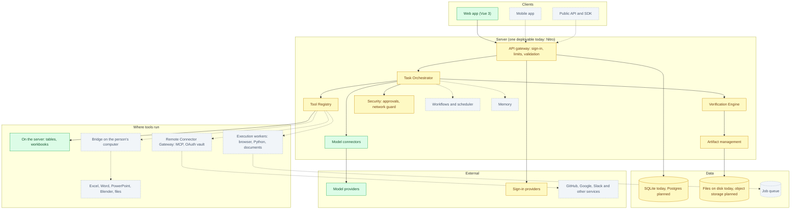
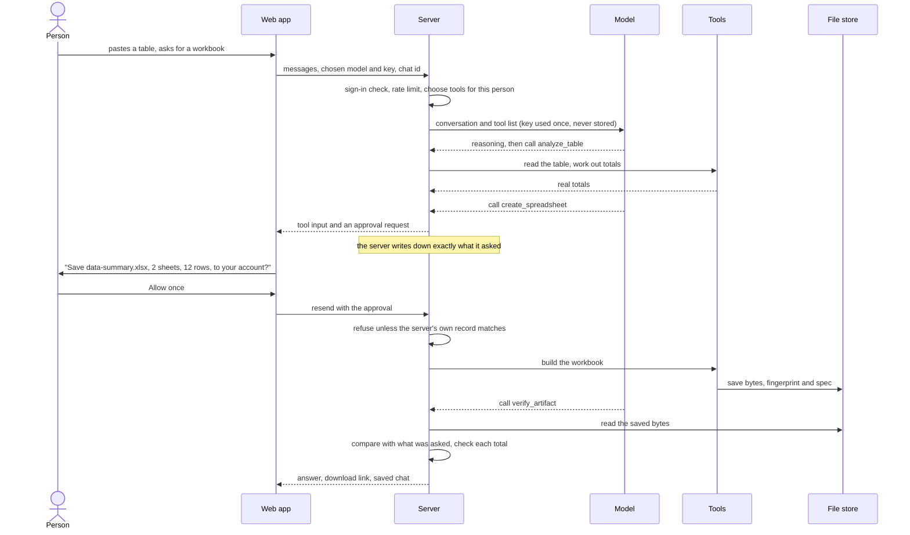

# OpenLobs architecture

This is the map of the whole project: what every part is for, how the parts fit together, what already exists, and what does not. It is written for three readers: people deciding whether to trust and use OpenLobs, people who want to contribute, and us, so we build the same thing.

**Honesty rule.** Every part has a status. A part marked *planned* is a design and a folder with a README, nothing more. We do not add placeholder code that looks finished. The current state of each feature is in [`../FEATURES.md`](../FEATURES.md).

Legend: ✅ built and tested · 🚧 partly built · 📋 planned (design only, no code)

## What OpenLobs is

An open agent workspace. A person describes a job. OpenLobs plans it, uses tools to do it (on the server, through connected services, in isolated workers, or on the person's own computer through the Bridge), shows what it is doing and why, asks before it changes anything, checks the result, and hands over the output.

## The principles everything follows

1. **Never trust the browser.** It sends the whole conversation back with every request. Anything that matters (an approval, who owns a file) is recorded and checked on the server.
2. **Show the work.** Every step says what it did, why, and where it ran.
3. **Ask before changing anything.** Anything that writes, sends or deletes waits for the person, and the question says exactly what will happen.
4. **Verify, do not assume.** A tool that returned is not proof of success. A result is "done" only after a check that could have failed.
5. **Least privilege.** Access to one capability never grants another. Permissions are per tool, per person, and can be revoked.
6. **Open by default.** Any model, any provider, any OpenAI-compatible address, self-hostable, no required cloud account.
7. **Replaceable parts.** Each module has an interface. Storage, queue, model provider and sign-in method can change without touching the rest.
8. **Honest status.** What is real, what is a demo and what is missing is always written down.

## The big picture

Solid boxes with a green fill exist and are tested. Yellow ones exist in part. Grey dashed ones are designs only.

## One request, end to end (what really happens today)

Turning a pasted table into a checked Excel file:

## Where to read next

| Topic | Document |
|---|---|
| Every module and its status | [`modules.md`](modules.md) |
| Task lifecycle, orchestrator, routing | [`runtime.md`](runtime.md) |
| The interface: routes, components, state, rules | [`frontend.md`](frontend.md) |
| The server: modules, requests, errors | [`backend.md`](backend.md) |
| Tables and how they relate | [`data-model.md`](data-model.md) |
| Threats, trust boundaries, what is protected | [`security.md`](security.md) |
| The desktop Bridge | [`bridge.md`](bridge.md) |
| HTTP API today and planned | [`api.md`](api.md) |
| Running it for real: deploy, scale, observe | [`deployment.md`](deployment.md) |
| The 15 ecosystem products and how they map to modules | [`products.md`](products.md) |
| Why we chose what we chose | [`../adr/`](../adr/README.md) |
| Where we are going and in what order | [`../../ROADMAP.md`](../../ROADMAP.md) |
