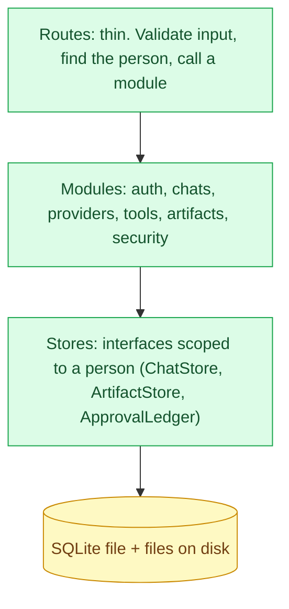

# Backend architecture

The server lives in `apps/web/server`. It is Nitro (the same tooling that serves the interface), so today there is one deployable. Status: 🚧 solid for accounts, chats, models, files and the first tools; planned for tasks, workers, connectors and workflows.

## Layers

- **Routes are thin.** They parse and validate the request (zod), identify the person, apply a rate limit, and call a module. No business rules live in a route.
- **Every store call takes the user id.** There is no function that reads a chat or a file without one. Isolation is a property of the interface, not something each caller remembers.
- **Stores are interfaces.** SQLite is the first implementation; Postgres and object storage are second implementations behind the same interface.

## Module map

| Folder | Responsibility | Status |
|---|---|---|
| `server/routes/api/` | HTTP surface (see `api.md`) | ✅ |
| `server/auth/` | Accounts and sessions (Better Auth): `config.ts` turns environment variables into settings, `auth.ts` builds it and creates tables, `mailer.ts` sends email, `session.ts` finds the person | ✅ |
| `server/chats/` | Saved chats, one record per chat | ✅ |
| `server/providers/` | Model providers: build a model, list models, refuse dangerous addresses, hide keys | ✅ (native adapters untested against real services) |
| `server/tools/` | The tools, the approval ledger and recorder, per-request context | 🚧 |
| `server/artifacts/` | The workbook builder and verifier, and the file store | 🚧 |
| `server/utils/` | `csv.ts`, `db.ts`, `rateLimit.ts`, `limits.ts`, `demoModel.ts`, `modelSelection.ts` | ✅ |
| (planned) `server/tasks/` | Stored tasks, steps and the orchestrator | 📋 |
| (planned) `server/connectors/` | Remote Connector Gateway | 📋 |
| (planned) `server/bridge/` | Bridge pairing and the socket | 📋 |
| (planned) `server/workflows/` | Workflows and the scheduler | 📋 |

## What happens on a chat request, in order

1. **Validate** the body: messages, an optional model choice, an optional chat id.
2. **Identify** the person from the session cookie (signed-out visitors are allowed and get no saved data).
3. **Rate limit** by person, or by network address when signed out.
4. **Resolve the model.** With a model choice: build it from the request's key (or a server key from the environment) and refuse addresses on private networks. Without one: the built-in demo model.
5. **Build the tools for this person.** File tools exist only when signed in.
6. **Stream** the AI SDK's tool loop (limit of 8 steps). Reasoning, tool input, approval requests and results are sent as they happen.
7. **Record approvals from the stream the server is sending** (never from what the browser returns).
8. **Save the chat** when the response ends, for signed-in people. A save failure never breaks the answer.
9. **Errors** are reduced to a sentence a person can read. Keys are removed from anything sent back.

## Configuration

Everything is environment variables, listed with explanations in `apps/web/.env.example`. In production the server **refuses to start** without a strong secret and an `https` public address. In development it makes a secret once and keeps it.

## Errors

| Kind | What the person sees | What is logged |
|---|---|---|
| Written for people (`ToolInputError`, rate limit, sign-in needed) | The message | Nothing sensitive |
| Provider failure | The provider's reason, with keys removed | The same |
| Anything unexpected | "That step did not work." | Details, on the server only |

## Conventions

- Validate at the edge with zod. Trust nothing inside a request body, including the conversation history.
- A module is a folder with an interface, an implementation and tests. If a second implementation is expected, the interface is written first.
- Time and randomness are passed in so tests can control them.
- Every security rule has a regression test that fails if the rule is removed.

## Known gaps

- **Migrations are not versioned.** Tables are created with `CREATE TABLE IF NOT EXISTS` after the auth library's own migration. That is fine until the first column change; then a `schema_version` table and numbered migrations are needed.
- **Observability is console logs only.** No request ids, metrics, tracing or error reporting.
- **Rate limiting is in memory,** so it covers one process only.
- **The OpenID Connect provider is discovered when the server starts.** If it is down then, its button is skipped until a restart.
- **Account deletion** is not built, and would need to remove stored files too.
- **No background work.** Everything runs inside the request.
