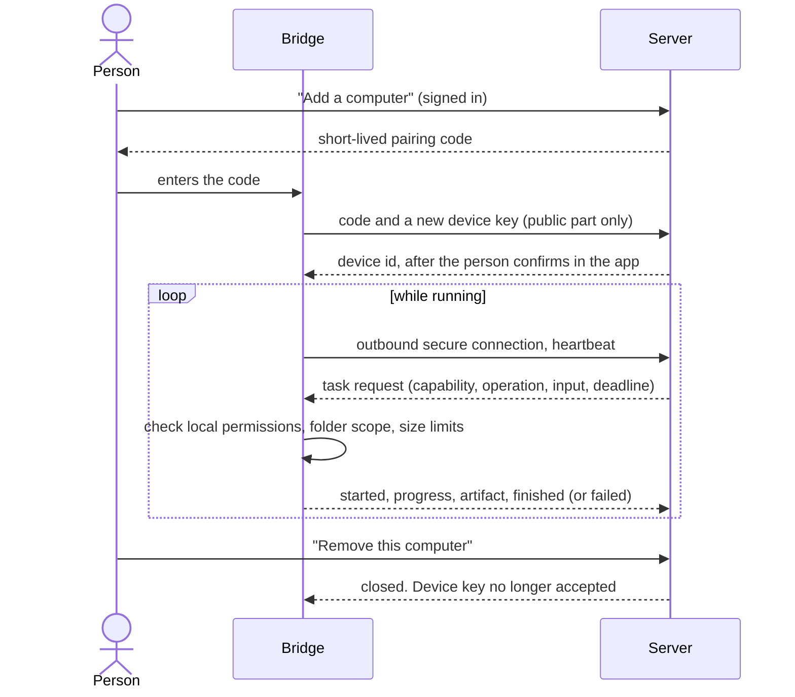

# The Bridge

Status: 📋 designed, nothing built. This is the part of OpenLobs with the most power and the most risk, so it is designed first and built last among the big pieces.

## What it is

A small app on a person's own computer. It lets OpenLobs do work with the applications and files already there (Excel, Word, PowerPoint, Blender, FL Studio, Git, Python, a browser) without OpenLobs ever having a way in that the person did not choose to open.

## Principles

1. **Outbound only.** The Bridge connects to OpenLobs. It never listens for incoming connections.
2. **The Bridge is the authority on its own computer.** Even if the server is compromised, the Bridge checks its own local rules before every action.
3. **Capabilities, not access.** The person enables specific things ("read and write files in this folder", "run Excel on files in this folder"). Each capability is separate; one never grants another.
4. **Visible.** When the Bridge is working it says so, and the person can stop it with one action. It keeps a local log.
5. **Revocable.** Revoking a device ends its connection immediately and invalidates its credentials.
6. **No silent inventory.** It reports only what the person enabled, not what is installed.

## Connecting

## Messages

Typed and versioned in `packages/bridge-protocol`. Every message is validated on both sides, carries a task id and a deadline, and is signed with the device key. A message that is malformed, expired, replayed or for a capability that is not enabled is refused and logged.

| Message | From | Meaning |
|---|---|---|
| `hello` | Bridge | Device id, version, operating system, enabled capabilities |
| `task.request` | Server | Capability, operation, input, deadline, approval id if one was required |
| `task.event` | Bridge | `started`, `progress`, `artifact`, `needs-approval`, `finished`, `failed`, `cancelled` |
| `task.cancel` | Server or person | Stop now |
| `revoke` | Server | Disconnect and forget |

## Permissions

| Scope | Example | Default |
|---|---|---|
| Folder | Read and write inside `Documents/OpenLobs` | Off. One folder is offered at pairing |
| Application | Run Excel on files inside the folder | Off |
| Desktop control | Click, type, read the screen | Off, and needs a fresh yes each session |

Rules: the Bridge refuses any path outside an enabled folder (after resolving links), refuses operations not listed for the capability, and caps size and duration. Actions that change something use the same approval flow as everything else: the server asks, the person says yes in the app, and the Bridge also confirms locally for the riskiest scope.

## Adapters

One adapter per application, each a separate capability.

| Adapter | First operations | Verification | Milestone |
|---|---|---|---|
| Files | List, read, write, move inside an enabled folder | Fingerprint, size, listing | M5 |
| Excel | Open, write cells and formulas, save | Re-open and compare, recompute totals | M5 |
| Word and PowerPoint | Generate and edit documents and slides | Re-open, check structure and text | M6 |
| Browser | Open pages, read, fill, screenshot | Page assertions, screenshots | M6 |
| Blender | Run a script, render | Render exists, size and frame checks | M7 |
| FL Studio | Open a project, export | Export exists, length check | M7 |
| Git and Python | Run an approved command in a folder | Exit code and tests | M7 |

Each adapter says what it can do (operations), what it needs (application version, platform) and how its output is verified. The Tool Registry lists them like any other tool, with the location "Bridge".

## Threats

| Threat | Response |
|---|---|
| A stolen device key | Revoke from the app; keys are bound to the device; connection needs a fresh handshake |
| The server tells the Bridge to do something unapproved | The Bridge checks local permissions and, for the riskiest scope, asks locally |
| A task reads outside its folder | Path checks after resolving links; the Bridge runs adapters with least privilege |
| A malicious file opened in an application | Adapters run with a timeout and, where possible, in a separate process; macros are off |
| Someone installs a fake Bridge | Signed installers and updates; the pairing code is entered on the real Bridge, not on a website |
| Silent background activity | A visible indicator while a task runs; a local log the person can read |

## Open questions

- **Which operating system first.** Windows is the likely choice (Excel, FL Studio) but this has not been confirmed with the owner.
- **How to automate Excel**: through the application, or by writing files directly. Direct file writing is safer and works without Excel installed; application control is needed only for features files cannot express.
- **Packaging and updates:** signing, auto-update, and how a person verifies they have the real app.
- **Offline behaviour** and what happens to a running task when the connection drops.

## Done when (first version)

- Pair, connect, heartbeat, reconnect and revoke work on one operating system.
- The Files adapter completes a task inside one folder, and the Verification Engine checks the result.
- A task outside the folder is refused, and a replayed or malformed message is refused (tested).
- Stop, pause and disconnect work during a running task.
