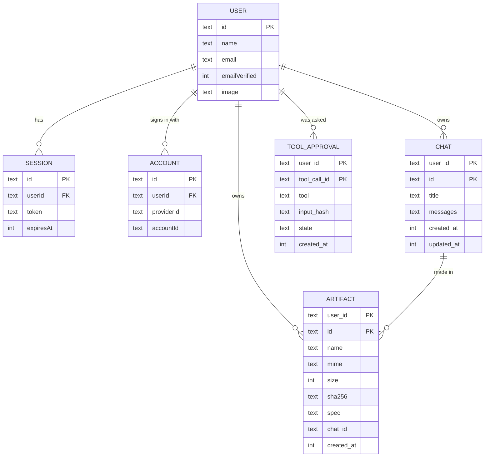
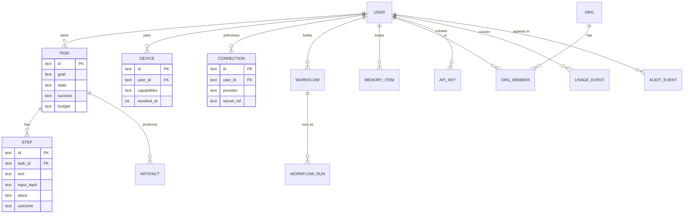

# Data model

Today everything lives in one SQLite file (`data/openlobs.db`, set by `OPENLOBS_DB_PATH`) plus a folder of files (`data/artifacts`, set by `OPENLOBS_ARTIFACTS_DIR`). Back up both together. Status: 🚧.

## Tables that exist

`USER`, `SESSION`, `ACCOUNT` (and a `verification` table for email links) belong to the sign-in library. The other three are ours. Rows that belong to a person are deleted with that person (`ON DELETE CASCADE`); the files on disk are not yet (a known gap).

**Why composite keys.** `chat`, `artifact` and `tool_approval` use `(user_id, id)` as their key. Another person guessing or reusing an id reaches nothing, because every query includes the user id.

**Why a chat is one record.** A whole conversation is one JSON value. It matches how the AI SDK holds messages and is simple. It stops being fine when chats get long or need search; the planned move is one row per message.

**What is deliberately not stored.** Model API keys. They live in the browser and travel with each request. (An operator may put provider keys in the server environment instead.)

## Planned additions

| Table | Purpose | Module | Milestone |
|---|---|---|---|
| `task`, `step` | Stored runs with state and budget | Orchestrator | M3 |
| `usage_event` | Tokens and cost per request, per model and tool | Model connectors | M3 |
| `audit_event` | Who approved and ran what, when, where | Security | M3 |
| `connection` | A person's connected services (credentials in a vault, only a reference here) | Connectors | M4 |
| `device` | Paired computers and what each may do | Bridge | M5 |
| `workflow`, `workflow_run`, `schedule` | Repeatable work | Workflows | M6 |
| `skill`, `skill_version` | Skills and their versions | Skills | M7 |
| `memory_item` | What a person chose to keep | Memory | M7 |
| `org`, `org_member`, `role` | Teams and permissions | Security | M9 |
| `api_key` | Scoped keys for the public API | SDK | M9 |

## Rules for any new table

1. It has an owner (a user or an organisation) in its key, and every query uses it.
2. It deletes with its owner, and anything stored outside the database is deleted too.
3. Secrets are stored encrypted or as a reference to a vault, never as plain text.
4. It has a migration that can run twice safely, and a test that proves one person cannot reach another's rows.

## Moving to a hosted database

The stores are interfaces, so Postgres is a second implementation of each. What changes: connection settings, migrations, and the rate limiter and approval ledger moving to a store every server process shares. Files move to object storage behind `ArtifactStore`. See `deployment.md`.
