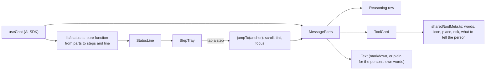

# Frontend architecture

The interface lives in `apps/web/src`. It is a Vue 3 single-page app built with Vite, Nuxt UI 4 and Tailwind 4, with file-based routing and layouts. Status: 🚧 the chat experience is built and tested; most other screens are planned.

## Stack

| Concern | Choice | Why |
|---|---|---|
| Framework | Vue 3 with `<script setup>` and TypeScript | Small, fast, readable by newcomers |
| Build | Vite, with Nitro serving the API from the same project | One deployable, one dev command |
| Components | Nuxt UI 4 (chat components included) | Accessible primitives, themeable, light and dark |
| Styling | Tailwind 4, design tokens in CSS | Consistent spacing and colour |
| Chat state | AI SDK's `useChat` | Streaming, tool parts and approvals are first-class |
| Routing | `vue-router` with file-based routes and layouts | A new page is a new file |
| Sign-in | Better Auth's Vue client | Sessions through cookies, no tokens in JavaScript |
| Icons | Lucide, custom OpenLobs set, brand marks (all bundled) | No requests to third parties, works offline |
| Font | Public Sans, bundled | Same reason |

## Route map

| Route | Screen | Status |
|---|---|---|
| `/` | New chat, with suggestions and a sample table to try | ✅ |
| `/chat/:id` | A saved chat | ✅ |
| `/sign-in` | Sign in or create an account, with only the methods that are configured | ✅ |
| `/forgot-password`, `/reset-password` | Password reset (needs email configured) | 🚧 server tested, screens not browser-tested |
| `/models` | Providers, keys, model lists, connection test | ✅ |
| `/icons` | Icon sheet (a development aid) | ✅ |
| `/bridge`, `/skills`, `/teams` | Placeholders that say "Coming in a later phase" | 📋 |
| `/files` | Your files: list, download, delete, preview | 📋 M2 |
| `/settings` | Profile, sign-in methods, sessions, two-factor, passkeys, delete account, export data | 📋 M3 |
| `/connections` | Connected services and what each may do | 📋 M4 |
| `/devices` | Paired computers (Bridge): permissions, activity, revoke | 📋 M5 |
| `/workflows`, `/workflows/:id`, `/schedules` | Build, run and schedule repeatable work | 📋 M6 |
| `/skills`, `/agents` | Create, test and install skills; agent teams | 📋 M7 |
| `/discover`, `/recipes`, `/community` | Find, start from, and share capabilities | 📋 M8 |
| `/usage` | Cost and usage per model and tool | 📋 M3 |
| `/admin` | Organisation, members, roles, audit log | 📋 M9 |

## Code layout

```
src/
  pages/            one file per route
  layouts/          default (sidebar) and blank (sign-in)
  components/
    chat/           ChatView, MessageParts, ToolCard, StatusLine, StepTray, ChatHistory
    models/         ModelPicker, ProviderPanel
    auth/           UserMenu
    brand/          LobMark
  composables/      useChats, useModels, useAuthConfig (small, shared state)
  lib/              status.ts (pure logic with tests), auth.ts
  icons/            the custom icon set
shared/             code used by both interface and server: providers, brands, toolMeta
```

## How the chat is put together



Rules that keep this healthy:

- **Logic that decides what the person is told lives in `lib/` as pure functions with tests.** Components draw; they do not decide.
- **One source of truth for steps:** they live in the message. The status line and tray only summarise them and point back.
- **A new tool needs one entry in `shared/toolMeta.ts`.** Without it the interface still works and uses readable generic words.
- **Anything the interface says about what will happen comes from the validated input, not the model's words.** The approval card reads the file name and row count from the tool input.
- **No global store.** State is either the conversation (`useChat`), small shared composables (module-level refs), the server (fetched), or the browser's storage (model keys).

## Design rules (from `../DESIGN_NOTES.md`)

- Flat. No cards and no border lines in the chat. Soft fills instead of outlines.
- Mobile first. Tap targets at least 44px. No sideways scrolling.
- Light and dark, both tested in the browser suites.
- Reduced motion respected: no animation, no scroll smoothing.
- Keyboard and screen reader: real buttons, labelled controls, focus moves to where the person was taken and returns when a sheet closes, live region for the status line.
- Honest labels: demo data says "Demo data"; a step never claims something happened before it did.

## Measured today (production build, not optimised)

| What | Size |
|---|---|
| All client JavaScript and CSS across 52 files, raw / compressed | 2.85 MB / 682 KB |
| The chat screen's own code | 862 KB / 245 KB |
| App entry | 384 KB / 115 KB |
| Styles | 260 KB / 34 KB |

Most of the language files are loaded only when a code block needs them. The chat screen is still too heavy for a first load on a slow phone. **Known weakness, planned fix (M3):** load the markdown and code-highlighting parts only when a message needs them, split the model screens out of the chat chunk, and set a budget in the build so it cannot grow unnoticed.

## Known gaps

- Content security policy is not set (see `security.md`).
- Markdown from the model is rendered by a library whose sanitising has not been audited by us.
- No offline behaviour, no installable app, no push notifications.
- Chat history loads the newest 200 chats and has no search.
- Renaming a chat exists in the API but not in the interface.
- Errors and notes above the message box are still separate lines; the plan is one line (see `../DESIGN_NOTES.md`).
