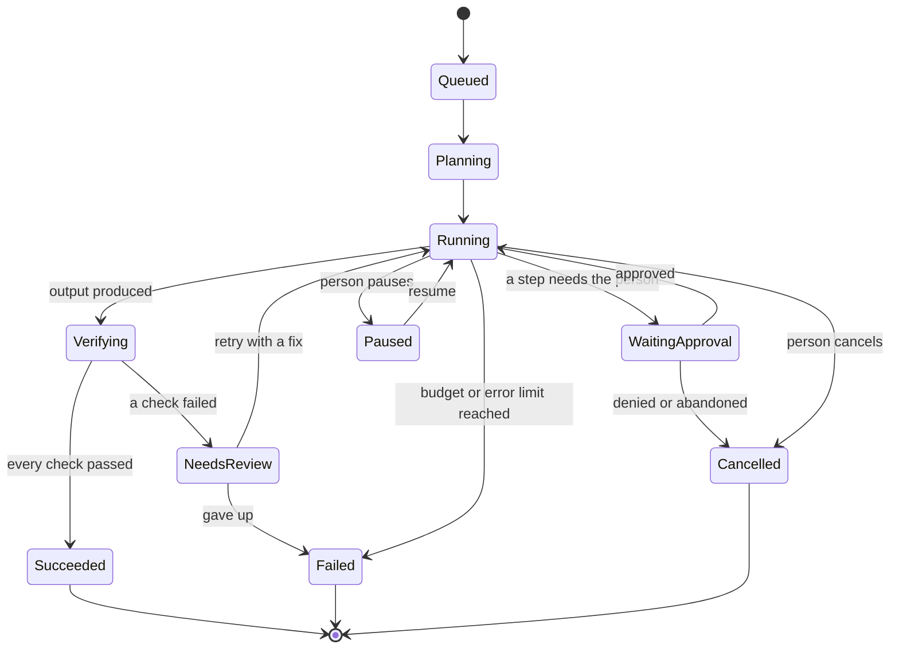

# Runtime: tasks, steps and the orchestrator

Status: 📋 designed, 🚧 a thin version runs today. See [`modules.md`](modules.md) for the module status.

## Today

A chat request runs the AI SDK's tool loop (up to 8 steps) inside one HTTP request. If a tool needs approval, the response ends, the person answers, and the browser sends a new request that continues. There is no stored task, no plan, no budget, no cancel beyond closing the request, and everything runs in the web process. That is right for "read a table and write a small workbook" and wrong for anything long.

## Target: a task is a stored thing

Every run becomes a **task** with a goal, success criteria, a budget and a state history. The chat shows it; it does not own it.

Rules:

- **Cancel works in every state**, immediately, and a cancelled task stops using tools.
- **A budget is enforced by the server**: steps, seconds, and (when known) cost. Exceeding it stops the task and says so.
- **Approval is a state**, not a message. A task waiting for approval holds no resources and can wait for a day.
- **Verification is a state.** A task cannot reach *Succeeded* without it.
- **A failed check does not mean failure.** It means *needs review*: retry with a fix, or tell the person plainly.

## Steps

A step is one action: a tool call, a model call, an approval, a check. Each step records who asked for it, which tool, the input fingerprint, the place it ran, the start and end, and the outcome. This is also what the step tray in the interface shows, and what the audit log keeps.

## The router

Choosing where and how each step runs, in layers (decided in `docs/DECISIONS.md`, D6):

| Layer | What it does | Status |
|---|---|---|
| L0 rules | Obvious cases by pattern ("a pasted table and the word workbook") | 🚧 the demo model's rules are a stand-in |
| L1 router model | A small model picks the plan and tools | 📋 |
| L2 skills | Load the skill that fits | 📋 |
| L3 policy | Per-person and per-organisation limits that cannot be overridden by a prompt | 📋 |

L3 always wins over L1 and L2.

## Execution location

The Tool Registry says where each tool may run. The orchestrator picks the safest place that works:

| Place | Used for | Isolation |
|---|---|---|
| Server, in process | Small, safe work: parse a table, build a small file | Same process: only for trusted code |
| Worker | Long, heavy or untrusted work: browser, Python, documents | Separate process or container, budgeted, no access to other people's data |
| Connector | Other services through their own interfaces | Per-person credentials, per-tenant isolation |
| Bridge | The person's own applications and files | The Bridge enforces its own permissions locally |

## Streaming and events

The interface renders a stream of events (text, reasoning, tool input, approval request, tool output, errors). Today that is the AI SDK message stream. Task state changes become events in the same stream so the interface never invents what it shows. The relationship to `packages/contract` is an open question in that module's README.

## Failure behaviour

- A tool error written for people (`ToolInputError`) is shown and given to the model so it can retry.
- Any other error is replaced with "That step did not work." and logged with details on the server only.
- A model that cannot call tools still chats; the interface says so.
- A provider failure shows what failed and offers to retry or switch model. Automatic fallback is planned.
