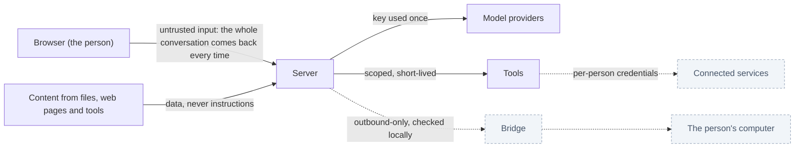

# Security model

Status: 🚧 the protections listed as built have tests. The gaps are listed plainly at the end. To report a vulnerability, see [`../../SECURITY.md`](../../SECURITY.md).

## What we protect

| Asset | Why it matters |
|---|---|
| A person's chats and files | Private work, possibly sensitive |
| Model API keys | They cost money and are tied to the person |
| Connected-service credentials (planned) | Access to a person's email, code, calendar |
| The person's computer (planned, through the Bridge) | The highest-value target in the system |
| The server and its other users | One person must never affect another |

## Trust boundaries

Three things never change: the browser is untrusted, content from outside is data, and an approval is only real if the server itself asked for it.

## Threats and what we do

| Threat | Protection | Status | Proof |
|---|---|---|---|
| A forged, edited or replayed approval makes a tool run | The server records each approval request from the response it sends, with a fingerprint of the exact input. A tool refuses to run without a matching, unused, fresh record for the same person | ✅ | Unit tests; a browser test sends a forged approval over HTTP and checks no file appears. (An earlier version had a hole: see the lesson in `../PROJECT_CONTEXT.md`) |
| One person reads or changes another's chats or files | Every store call is scoped by user id; keys are `(user_id, id)`; another person's id looks like a missing one | ✅ | Unit and browser tests |
| A model address points at an internal service (SSRF) | Private, loopback, link-local and cloud-metadata addresses are refused in production; metadata and link-local are refused always, including the IPv6-mapped form | ✅ (residual: a hostile name server could answer differently on connect; restrict egress at the network too) | Unit tests |
| Keys leak through errors | Keys are removed from every error text. The server does not store keys | ✅ | Unit tests |
| A key is stolen from the browser | Keys are kept in the browser's storage, so any script running on the page could read them | ⚠ accepted for now; mitigated by a content security policy and by using limited keys | 📋 |
| Cross-site request | Same-site cookies, and the sign-in library checks the request's origin | ✅ | Browser test |
| Guessing passwords or flooding | Rate limits on sign-in, chat and provider routes. Sign-in limits switch on in production | 🚧 in-memory, one process |  Unit tests |
| Prompt injection (text in a file or page tells the model what to do) | Tool and file content is labelled as data in the model's instructions. Nothing with side effects runs without the person's approval, and the approval card is built from the validated input, not the model's words | 🚧 | The approval card test |
| Spreadsheet formula injection | Text is stored as text, never as a formula, and verification checks it | ✅ | Unit tests, openpyxl cross-check |
| Path traversal in file storage | Paths come from generated ids and a hash of the user id, never from user input | ✅ | Unit tests |
| Resource exhaustion | Input caps (table size, file size, rows), per-person file quotas, rate limits | 🚧 per-request time and memory budgets need workers |  Unit tests |
| Account takeover through sign-in methods | Accounts join only when a trusted provider vouches for the same email; email confirmation is required when mail is configured | 🚧 see gaps |  Unit tests |
| Malicious uploads | There are no uploads yet. Plan: type and size checks, parse inside a worker, never on the web process | 📋 | |
| Supply chain | Lockfile; mostly MIT and Apache dependencies. No automated audit in CI yet | 📋 | |
| The Bridge is abused to reach a computer | See `bridge.md` | 📋 | |
| Operator reads people's files | Files are readable by whoever runs the server. Encryption at rest and per-person keys are planned | 📋 | |

## Secrets

- **Model keys:** browser storage by default; server environment variables if an operator chooses.
- **Session secret:** required and at least 32 characters in production; the server refuses to start otherwise.
- **Connector credentials (planned):** envelope encryption, a stored token record per person and provider, and short-lived sessions that never expose the raw provider token.
- **Nothing secret goes into logs, the repository, prompts, or error messages.**

## Approvals, precisely

1. The model produces a tool call that needs approval.
2. The server sends the tool input and an approval request. As it passes through the response stream, the server records: person, tool call id, tool name, and a fingerprint of the input *as the tool's schema reads it*.
3. The person answers in the interface. The browser sends the conversation back with the answer.
4. The tool runs only if the server finds its own record for that person, tool and input, unused and less than an hour old. The record is marked used.
5. Anything else (invented call, edited input, reused approval, another person's, expired) is refused with a plain message.

Why not trust the browser's "approved": the browser could be a compromised page, an edited request, or a replay. The person is allowed to say yes; they are not allowed to make the server believe it asked something it did not.

## Known gaps (this list is the security to-do list)

1. No content security policy. 
2. No audit log of approvals and tool runs.
3. Rate limiting is per process.
4. Sign-up in production without email configured has no address confirmation. The server should refuse that combination or close sign-ups.
5. The sign-in library stores provider access tokens in its `account` table. We do not use them yet. Either stop storing them or enable its token encryption (to be checked against the library's current options).
6. No two-factor or passkeys; no session list or "sign out everywhere".
7. No automated dependency audit in CI.
8. Markdown rendering has not been audited for script injection.
9. Files are not encrypted at rest, and are not removed when an account is deleted.
10. Backups are not handled by the app.
